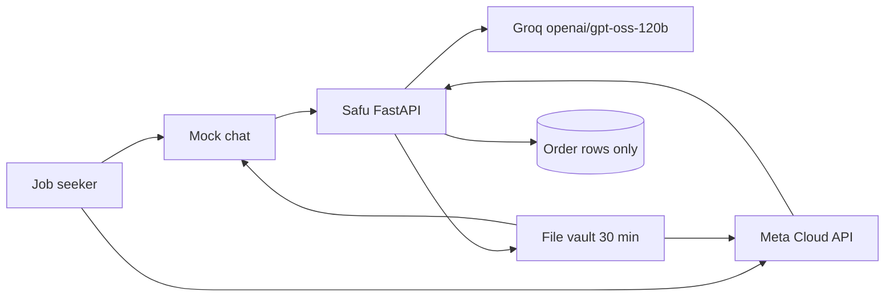

# Safu

Safu is a WhatsApp CV studio. A job seeker sends the CV they already have and one job post. The agent collects anything still missing, shows the facts it extracted, and only then writes an ATS-friendly CV (editable Word and PDF), a cover letter, and an interview pack. Every employer, date, qualification, and figure in the draft is checked against the extracted record.

The demo runs in mock mode: a fake WhatsApp chat in the browser, no Meta token, and no model key. With a Groq key, the same service calls Groq.

## Run the demo

```bash
./scripts/demo.sh
```

That creates `.venv` if you need one, installs dependencies, and serves the app on [http://127.0.0.1:8765](http://127.0.0.1:8765).

Open [the mock chat](http://127.0.0.1:8765/demo) and press **Play sample order**. Amina Wanjiku and Freightline Kenya are fictional. Photo reading needs the `tesseract` binary (`sudo apt install tesseract-ocr` on Debian or Ubuntu).

Tests:

```bash
make test
```

## What a completed order does

1. Asks for the candidate's name.
2. Reads a CV from PDF, DOCX, a photo (OCR), a URL, or pasted text.
3. Reads the job post the same way.
4. Shows employers, dates, education, and contact details. Nothing is generated until the person replies YES.
5. Shows the price and waits for PAY. The included gateway is a stub and does not charge.
6. Rewrites the CV, checks it, and scores it.
7. Sends `CV.docx`, `CV.pdf`, `Cover-Letter.docx`, `Cover-Letter.pdf`, `Interview-Prep.docx`, and `Interview-Prep.pdf`, plus an ATS score and a job-match score.

Say HUMAN at any point to flag a person. Say STOP to delete the working files and close the order. Say RESEND within 30 minutes for fresh links. Say NEW to start another application.

## Architecture



Safu is the system of record.

- Conversation, extraction, validation, scoring, and document rendering live in this Python service.
- The default model is Groq `openai/gpt-oss-120b` through the OpenAI-compatible API at `https://api.groq.com/openai/v1`. Gemini, OpenAI, and Claude are config switches. With no key, a local writer lays the extracted facts into ATS headings. That writer is also the fallback when Groq returns a 429 or a draft that fails validation.
- Order state can sit in memory or in Supabase. The row is step, status, payment flag, hand-off flag, a pack id, and an error code. Message ids are stored so a retried webhook is ignored. There is no column for CV text.
- Generated files sit in `var/files` and expire 30 minutes after a successful delivery. The working copy in `var/work` is deleted at that moment. Neither directory is a database, and neither is served as a listing.
- A loop retries failed generation or delivery about once a minute, sends one follow-up 48 hours after an unfinished order goes quiet, and deletes expired files. Alerts fire when a step fails, when validation rejects a draft, when Groq rate-limits a request, and when a person is needed.
- Payment is a `start` / `confirm` interface. `StubPaymentGateway` is the only implementation shipped here.

### Platform recommendation

Use this Python service as the core, and point Meta's webhook at `POST /webhook` directly.

Self-hosted n8n is a reasonable optional front door if someone wants to see the webhook on a canvas. Import `n8n/safu-whatsapp.workflow.json` and forward the body to Safu. Keep n8n from storing execution data that contains CV text. n8n should not own validation, file expiry, or the order row.

Make, Zapier, and GoHighLevel are a poor fit as the system of record. They keep task payloads in a vendor log, which fights the rule that CV content is not stored, and the fact-check is awkward to test there. Use them only as a notifier after Safu has already removed the CV from the payload.

Supabase's free tier is enough for the order table. Run `supabase/schema.sql` and set `ORDER_STORE=supabase`. Do not add a CV column later.

## Cost

### Groq free tier

The default model is `openai/gpt-oss-120b` on Groq's free plan. Groq's published rate-limit table lists these caps for that model. They apply per organization, not per key. Groq describes the table as a summary and says the limits page in the account is the exact number. Source: [Groq rate limits](https://console.groq.com/docs/rate-limits).

| Limit | Free plan for `openai/gpt-oss-120b` |
| --- | --- |
| Requests per minute | 30 |
| Requests per day | 1,000 |
| Tokens per minute | 8,000 |
| Tokens per day | 200,000 |

Input and output tokens both count. Cached prompt tokens do not. A limit returns HTTP 429, with `retry-after` and `x-ratelimit-*` headers. Safu treats 429 as a signal to send the fact-locked local pack and raise `llm_rate_limited`, so the person still gets documents.

One pack is a single Groq call. A second call happens only when validation rejects the first draft. The prompt is the extracted record (employers, dates, bullets, skills) plus the job's title and keywords, not the raw file. Even so, 8,000 tokens per minute is the tight cap: generate one pack at a time on the free plan. The daily request cap (1,000) is looser than the daily token cap (200,000) for this workload. A few thousand tokens per pack means a few dozen packs a day before the token cap, fewer when CVs are long.

The Developer plan raises these limits and adds Batch and Flex. Confirm current numbers on the account limits page before a launch. They move.

Set `LLM_PROVIDER=local` to skip Groq entirely. Leave `GROQ_API_KEY` empty and the service does the same thing and says so on `/api/health`.

### Other providers

| `LLM_PROVIDER` | Key | Default model | Endpoint |
| --- | --- | --- | --- |
| `groq` (default) | `GROQ_API_KEY` | `openai/gpt-oss-120b` | `https://api.groq.com/openai/v1` |
| `gemini` | `GEMINI_API_KEY` | `gemini-2.0-flash` | Gemini's OpenAI-compatible endpoint |
| `openai` | `OPENAI_API_KEY` | `gpt-4o-mini` | `https://api.openai.com/v1` |
| `anthropic` | `ANTHROPIC_API_KEY` | `claude-haiku-4-5` | `https://api.anthropic.com` |
| `local` | none | safe local writer | none |

Gemini, OpenAI, and Claude are optional. Their prices and free quotas are theirs, not Groq's. The validator runs on every provider.

### Everything else

- WhatsApp: Meta's test number is for development. Production traffic is billed by Meta under their current conversation pricing.
- Supabase: the free tier holds the order rows. Files do not go there.
- The chat shows KES 1,500. The stub gateway records PAY and moves no money.
- Tesseract is a local binary for photos. PDF and Word do not need it.

## Setup

```bash
python3 -m venv .venv
.venv/bin/pip install -r requirements.txt
cp .env.example .env
./scripts/demo.sh
```

Environment variables are listed in `.env.example`. None are hard-coded.

### Credentials to go live

1. Meta WhatsApp Cloud API: a test or production number, a permanent token (`WHATSAPP_TOKEN`), the phone number id, a verify token, and the app secret.
2. A public HTTPS URL. Set `PUBLIC_BASE_URL` and point Meta's webhook at `https://<host>/webhook`.
3. `GROQ_API_KEY` from [console.groq.com/keys](https://console.groq.com/keys). Leave the model as `openai/gpt-oss-120b` unless you have a reason to change it.
4. A Supabase project. Run `supabase/schema.sql`, then set `ORDER_STORE=supabase`, `SUPABASE_URL`, and `SUPABASE_SERVICE_KEY`.
5. `APP_MODE=live` and `ALLOW_LOCAL_URLS=false`.
6. `OPS_TOKEN` so `/api/ops/*` is not open.
7. Optional `ALERT_WEBHOOK_URL` (a Slack incoming webhook is enough). The body is level, code, order id, and a short reason. It does not include CV text.
8. Tesseract on the host if candidates will send photos.
9. A real payment class behind `build_payments` when the client picks M-Pesa or a card acquirer. Until then the stub remains.

`FILE_TTL_SECONDS` defaults to 1800. `FOLLOWUP_AFTER_HOURS` defaults to 48.

## Tests

`make test` covers:

- PDF, DOCX, OCR, and URL extraction
- rejection of a fabricated employer, date, qualification, figure, and skill
- a safe pack that passes the same checks
- the Groq request shape (`/chat/completions`, bearer key, model id) without calling Groq
- Gemini, OpenAI, and Claude config selection
- fallback when a draft fails validation or Groq returns 429
- an end-to-end order: no files before YES, no files before PAY, then six documents, scores, and a duplicate webhook that does not build a second pack
- delivery failure and generation failure, both recovered into a delivered pack
- one 48-hour follow-up
- human hand-off
- file expiry at 30 minutes and a 410 afterwards
- order rows and the Supabase payload containing no CV text
- logs that do not contain CV sentences

## Data protection

- Generated files are deleted 30 minutes after delivery. `GET /files/{token}` then returns 410.
- Undelivered files and working copies are deleted after `MAX_HOLD_SECONDS` (48 hours by default) if a crash left them behind.
- The order store's field list is fixed in code (`ORDER_FIELDS`) and in `supabase/schema.sql`.
- Logs go through an allow-list of fields. Message bodies are not logged.
- URL fetch allows only http(s), blocks link-local and metadata hosts, and blocks localhost unless mock mode (or `ALLOW_LOCAL_URLS`) is on.
- The demo inspector shows the live database row and whether any CV line is inside it.

## Operations

- `GET /api/health` shows mode, provider, model, and whether a live key is loaded.
- `POST /api/ops/recovery/run`, `POST /api/ops/followups/run`, `POST /api/ops/sweep`, and `GET /api/ops/alerts` are open in mock mode. In live mode they require `X-Ops-Token`.
- Alerts fire at the moment of failure. The recovery loop retries within about a minute. Five failures hand the order to a person.
- Background loops start with the server. Set `BACKGROUND_TASKS=0` to disable them.
