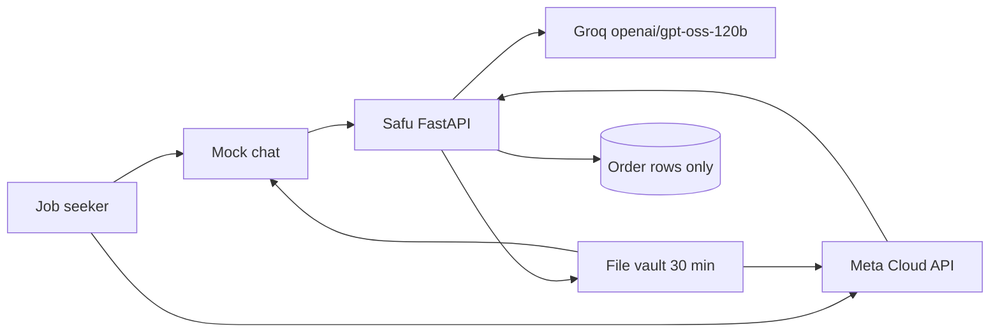

# Safu

Safu is a WhatsApp CV studio. A job seeker sends the CV they already have and one job post. The agent collects anything still missing, shows the facts it extracted, and only then writes an ATS-friendly CV (editable Word and PDF), a cover letter, and an interview pack. Every employer, date, qualification, and figure in the draft is checked against the extracted record.

The demo runs in mock mode: a fake WhatsApp chat in the browser, no Meta token, and no model key. With a Groq key, the same service calls Groq.

## Run the demo

```bash
./scripts/demo.sh
```

That creates `.venv` if you need one, installs dependencies, and serves the app on [http://127.0.0.1:8765](http://127.0.0.1:8765).

Open [the mock chat](http://127.0.0.1:8765/demo) and press **Play sample order**. Amina Wanjiku and Freightline Kenya are fictional. Photo reading tries Groq vision when `GROQ_API_KEY` is set, and falls back to the `tesseract` binary (`sudo apt install tesseract-ocr` on Debian or Ubuntu).

Tests:

```bash
make test
```

## What a completed order does

1. Asks for the candidate's name.
2. Reads a CV from PDF, DOCX, a photo (OCR), a URL, or pasted text.
3. Reads the job post the same way.
4. Shows employers, dates, education, and contact details. Nothing is generated until the person replies YES.
5. Shows the price and waits for a confirmed payment. The demo gateway is a stub: reply PAY, nothing is charged. M-Pesa and Paystack release the documents only after the provider confirms.
6. Rewrites the CV, checks it, and scores it.
7. Sends `CV.docx`, `CV.pdf`, `Cover-Letter.docx`, `Cover-Letter.pdf`, `Interview-Prep.docx`, and `Interview-Prep.pdf`, plus an ATS score and a job-match score.

Say HUMAN at any point to flag a person. Say STOP to delete the working files and close the order. Say RESEND within 30 minutes for fresh links. Say NEW to start another application.

## Architecture



Safu is the system of record.

- Conversation, extraction, validation, scoring, and document rendering live in this Python service.
- The default model is Groq `openai/gpt-oss-120b` through the OpenAI-compatible API at `https://api.groq.com/openai/v1`. Gemini, OpenAI, and Claude are config switches. With no key, a local writer lays the extracted facts into ATS headings. That writer is also the fallback when Groq returns a 429 or a draft that fails validation.
- Order state can sit in memory or in Supabase. The row is step, status, payment flag, hand-off flag, a pack id, and an error code. Message ids are stored so a retried webhook is ignored. There is no column for CV text.
- Generated files sit in `var/files` and expire 30 minutes after a successful delivery. The working copy in `var/work` is deleted at that moment. Neither directory is a database, and neither is served as a listing.
- A loop retries failed generation or delivery about once a minute, sends one follow-up 48 hours after an unfinished order goes quiet, and deletes expired files. On a live WhatsApp number that follow-up is the approved template `safu_followup_48h` (free text is blocked after 24 hours). The same job runs from `POST /api/cron/tick` so a free external cron can wake the Render service. Alerts fire when a step fails, when validation rejects a draft, when Groq rate-limits a request, and when a person is needed. With Gmail or Telegram configured they go to the owner. With neither, they stay in demo mode.
- Payment is a `start` / `confirm` interface selected by `PAYMENT_PROVIDER`: `stub`, `mpesa` (Daraja STK Push), or `paystack` (test checkout link plus a signed webhook). Documents are generated only after payment is confirmed, unless `REQUIRE_PAYMENT=false`.

### Platform recommendation

Use this Python service as the core, and point Meta's webhook at `POST /webhook` directly.

Self-hosted n8n is a reasonable optional front door if someone wants to see the webhook on a canvas. Import `n8n/safu-whatsapp.workflow.json` and forward the body to Safu. Keep n8n from storing execution data that contains CV text. n8n should not own validation, file expiry, or the order row.

Make, Zapier, and GoHighLevel are a poor fit as the system of record. They keep task payloads in a vendor log, which fights the rule that CV content is not stored, and the fact-check is awkward to test there. Use them only as a notifier after Safu has already removed the CV from the payload.

Supabase's free tier is enough for the order table. Run `supabase/schema.sql` and set `ORDER_STORE=supabase`. Do not add a CV column later.

## Cost

### Groq free tier

The default model is `openai/gpt-oss-120b` on Groq's free plan. Groq's published rate-limit table lists these caps for that model. They apply per organization, not per key. Groq describes the table as a summary and says the limits page in the account is the exact number. Source: [Groq rate limits](https://console.groq.com/docs/rate-limits).

| Limit | Free plan for `openai/gpt-oss-120b` |
| --- | --- |
| Requests per minute | 30 |
| Requests per day | 1,000 |
| Tokens per minute | 8,000 |
| Tokens per day | 200,000 |

Input and output tokens both count. Cached prompt tokens do not. A limit returns HTTP 429, with `retry-after` and `x-ratelimit-*` headers. Safu treats 429 as a signal to send the fact-locked local pack and raise `llm_rate_limited`, so the person still gets documents.

One pack is a single Groq call. A second call happens only when validation rejects the first draft. The prompt is the extracted record (employers, dates, bullets, skills) plus the job's title and keywords, not the raw file. Even so, 8,000 tokens per minute is the tight cap: generate one pack at a time on the free plan. The daily request cap (1,000) is looser than the daily token cap (200,000) for this workload. A few thousand tokens per pack means a few dozen packs a day before the token cap, fewer when CVs are long.

The Developer plan raises these limits and adds Batch and Flex. Confirm current numbers on the account limits page before a launch. They move.

Set `LLM_PROVIDER=local` to skip Groq entirely. Leave `GROQ_API_KEY` empty and the service does the same thing and says so on `/api/health`.

### Other providers

| `LLM_PROVIDER` | Key | Default model | Endpoint |
| --- | --- | --- | --- |
| `groq` (default) | `GROQ_API_KEY` | `openai/gpt-oss-120b` | `https://api.groq.com/openai/v1` |
| `gemini` | `GEMINI_API_KEY` | `gemini-2.0-flash` | Gemini's OpenAI-compatible endpoint |
| `openai` | `OPENAI_API_KEY` | `gpt-4o-mini` | `https://api.openai.com/v1` |
| `anthropic` | `ANTHROPIC_API_KEY` | `claude-haiku-4-5` | `https://api.anthropic.com` |
| `local` | none | safe local writer | none |

Gemini, OpenAI, and Claude are optional. Their prices and free quotas are theirs, not Groq's. The validator runs on every provider.

### Everything else

- WhatsApp: Meta's test number is for development. Production traffic is billed by Meta under their current conversation pricing.
- Supabase: the free tier holds the order rows. Files do not go there.
- The chat shows KES 1,500. The stub gateway records PAY and moves no money. M-Pesa sandbox and Paystack test mode are free to exercise and do not move live money.
- Photos are read by Groq's free vision model (`qwen/qwen3.8-27b` by default) and, if that call fails, by Tesseract. PDF and Word do not need either. The free Render Python image has no Tesseract binary; vision covers it. `Dockerfile` installs Tesseract for a new Docker service.

## Setup

```bash
python3 -m venv .venv
.venv/bin/pip install -r requirements.txt
cp .env.example .env
./scripts/demo.sh
```

Environment variables are listed in `.env.example`. None are hard-coded.

## Deploy to Render

The free web service is a single Python process (512 MB). It binds to Render's `$PORT`. With only `GROQ_API_KEY` filled in, the public URL serves the mock WhatsApp demo and calls Groq `openai/gpt-oss-120b`. Missing Supabase keys use a local SQLite file. Missing WhatsApp keys keep the app in demo mode, even if `APP_MODE` is set to `live`.

[](https://render.com/deploy?repo=https://github.com/sharmavijay07/whatsapp-cv-builder-agent)

`render.yaml` is the blueprint. Render runs:

- Build: `pip install --no-cache-dir -r requirements.txt`
- Start: `python -m safu`

The process listens on `0.0.0.0:$PORT` with one worker. File links use `RENDER_EXTERNAL_URL` when `PUBLIC_BASE_URL` is unset.

Required for rewriting and for photo reading:

- `GROQ_API_KEY` — `sync: false`. If you leave it blank, the demo still loads and uses the local fact-locked writer, and photos need Tesseract.

Set by the blueprint:

- `LLM_PROVIDER=groq`
- `GROQ_MODEL=openai/gpt-oss-120b`
- `GROQ_BASE_URL=https://api.groq.com/openai/v1`
- `GROQ_VISION_MODEL=qwen/qwen3.8-27b`
- `OCR_PROVIDER=auto`
- `REQUIRE_PAYMENT=true`
- `MPESA_ENV=sandbox`
- `WHATSAPP_FOLLOWUP_TEMPLATE=safu_followup_48h`
- `WHATSAPP_TEMPLATE_LANGUAGE=en`
- `DATA_DIR=/tmp/safu`
- `HOST=0.0.0.0`
- `PYTHON_VERSION=3.12.8`

`APP_MODE`, `ORDER_STORE`, and `PAYMENT_PROVIDER` are `sync: false`. When they are unset the process uses `mock`, `sqlite`, and `stub`. The service that is already running was created with `APP_MODE=mock` and `ORDER_STORE=sqlite`.

`PORT` is injected by Render. Do not set it yourself.

Secrets in `render.yaml` are `sync: false`. On this service, which already exists, a Blueprint sync does **not** add new `sync: false` keys. Add them in the [Render dashboard](https://dashboard.render.com/web/srv-dbrdaot9fdbs73e26srg) for `whatsapp-cv-builder`. The service runtime is Python and cannot be changed in place. Photo reading on it uses Groq vision. `Dockerfile` is the Tesseract path if you create a **new** free Docker web service from this repo.

`FILE_TTL_SECONDS` defaults to 1800. `FOLLOWUP_AFTER_HOURS` defaults to 48. `REQUIRE_PAYMENT` defaults to true.

## Go live with free tools

Do these in order. Every account below has a free tier. No paid Render plan, paid WhatsApp number, or live card charge is required to prove the path. The public URL is `https://whatsapp-cv-builder.onrender.com`.

Set `ALLOW_LOCAL_URLS=false` when you leave mock mode. Leave `LLM_PROVIDER=groq`, `GROQ_MODEL=openai/gpt-oss-120b`, and `GROQ_VISION_MODEL=qwen/qwen3.8-27b`.

### 1. Groq (rewrites and photo reading)

1. Open [console.groq.com/keys](https://console.groq.com/keys) and create a key. No card.
2. Set `GROQ_API_KEY`.
3. Photos go to `qwen/qwen3.8-27b` first. If that call fails, Safu tries Tesseract. On this Python service Tesseract is not installed, so the Groq key is what makes photo reading work.

### 2. Meta WhatsApp test number (free)

1. Go to [developers.facebook.com](https://developers.facebook.com/), create an app, and add the WhatsApp product.
2. In **WhatsApp → API setup**, copy the temporary token into `WHATSAPP_TOKEN` and the phone number ID into `WHATSAPP_PHONE_NUMBER_ID`. For a token that survives 24 hours, create a system user in Business Settings and generate a token with `whatsapp_business_messaging` and `whatsapp_business_management`.
3. Add your own handset under **To** on that page. The test number only delivers to numbers you add.
4. **App settings → Basic**: copy the app secret into `WHATSAPP_APP_SECRET`.
5. Choose a verify string, set `WHATSAPP_VERIFY_TOKEN` to it, and set the callback URL to `https://whatsapp-cv-builder.onrender.com/webhook`.
6. Subscribe the webhook to `messages`.
7. Set `APP_MODE=live`. With the four WhatsApp values missing, Safu stays in mock mode even if this is `live`.
8. Submit the follow-up template before you rely on the 48-hour nudge. WhatsApp rejects free-form text after 24 hours, and this nudge is sent at 48. In **WhatsApp Manager → Message templates**, create a Utility template, or POST `meta/safu_followup_48h.json` to `https://graph.facebook.com/v21.0/{WHATSAPP_BUSINESS_ACCOUNT_ID}/message_templates` with `Authorization: Bearer $WHATSAPP_TOKEN`. The name is `safu_followup_48h`, language `en`. Wait until Meta marks it approved. `WHATSAPP_FOLLOWUP_TEMPLATE` and `WHATSAPP_TEMPLATE_LANGUAGE` already match that file.
9. Session messages (text, reply buttons, documents) work inside the 24-hour window on the test number. Safu sends YES / HUMAN buttons, a Pay now link button, and the six documents through the Cloud API.

### 3. M-Pesa Daraja sandbox (free) or Paystack test mode (free)

Pick one with `PAYMENT_PROVIDER`. Leave it as `stub` to keep the demo. `REQUIRE_PAYMENT=true` means no documents until the gateway confirms.

**Daraja sandbox**

1. Create an app at [developer.safaricom.co.ke](https://developer.safaricom.co.ke/).
2. Copy the sandbox consumer key and secret to `MPESA_CONSUMER_KEY` and `MPESA_CONSUMER_SECRET`.
3. Set `MPESA_ENV=sandbox`, `MPESA_SHORTCODE=174379`, and `MPESA_PASSKEY` from the simulator page (Lipa Na M-Pesa Online).
4. Optionally set `MPESA_CALLBACK_SECRET` to a long random string. Safu appends it to the callback as `?token=`. The callback Safu registers is `https://whatsapp-cv-builder.onrender.com/webhooks/mpesa`.
5. Set `PAYMENT_PROVIDER=mpesa`.
6. Safu sends an STK push to the candidate's number. The pack is sent only when the callback `ResultCode` is 0, the checkout id is one Safu created, and the amount is at least the price. Use the sandbox test MSISDN from the Daraja portal. This does not move real money.

**Paystack test**

1. Create an account at [dashboard.paystack.com](https://dashboard.paystack.com/) and stay in **Test mode**.
2. Copy the test secret (`sk_test_...`) to `PAYSTACK_SECRET_KEY`. A key that starts with `sk_live_` is refused unless `PAYSTACK_ALLOW_LIVE=true`.
3. Set the webhook URL to `https://whatsapp-cv-builder.onrender.com/webhooks/paystack`. Safu checks `x-paystack-signature` (HMAC-SHA512 of the raw body) and the amount.
4. Set `PAYMENT_PROVIDER=paystack`. The chat gets a checkout link. Documents follow `charge.success` only.

### 4. Gmail alerts (free) and optional Telegram (free)

1. On the Google account that should receive alerts, turn on 2-Step Verification, then create an app password: [myaccount.google.com/apppasswords](https://myaccount.google.com/apppasswords).
2. Set `GMAIL_USER` to that Gmail address, `GMAIL_APP_PASSWORD` to the 16-character app password, and `OWNER_EMAIL` to the same address (or another inbox). Safu sends through `smtp.gmail.com:465`.
3. The message is level, code, order id, and a short reason. It does not include CV text.
4. Optional Telegram: talk to [@BotFather](https://t.me/BotFather), create a bot, put the token in `TELEGRAM_BOT_TOKEN`, and put your chat id in `TELEGRAM_CHAT_ID`.
5. Optional `ALERT_WEBHOOK_URL` for a Slack incoming webhook. The JSON body is the same four fields.
6. If `GMAIL_USER`, `GMAIL_APP_PASSWORD`, `OWNER_EMAIL`, Telegram, and `ALERT_WEBHOOK_URL` are all empty, alerts stay in demo mode (memory and the log only).

### 5. Supabase free tier (optional)

SQLite on the instance is the default and needs no account. The disk is ephemeral: order rows and pending payment references disappear when the free service spins down. Use Supabase if they should survive.

1. Create a project at [supabase.com](https://supabase.com/). The free tier is enough.
2. In the SQL editor, run `supabase/schema.sql`. That creates `orders`, `processed_messages`, and `payments`. There is no CV column.
3. Project Settings → API: set `SUPABASE_URL` to the project URL and `SUPABASE_SERVICE_KEY` to the service role key.
4. Set `ORDER_STORE=supabase`.

### 6. Admin token and the 48-hour cron (free)

1. Generate a long random string and set `ADMIN_TOKEN`. `/api/ops/*` then requires `Authorization: Bearer <ADMIN_TOKEN>`. In mock mode with the token unset, those routes stay open so the demo recovery button works. In live mode they are closed until the token is set. `OPS_TOKEN` is still accepted as the same bearer (or `X-Ops-Token`) if you already used that name.
2. Set `CRON_SECRET` to a different random string. `POST /api/cron/tick` runs follow-ups, delivery recovery, and the file sweep. `ADMIN_TOKEN` is also accepted. The route is closed when neither is set.
3. Render's free web service sleeps after about 15 minutes, so the in-process loop does not fire while it is asleep. Create a free job at [cron-job.org](https://cron-job.org/) (or any free cron):
   - URL: `https://whatsapp-cv-builder.onrender.com/api/cron/tick`
   - Method: POST
   - Header: `Authorization: Bearer <CRON_SECRET>`
   - Schedule: once an hour is enough for a 48-hour nudge
4. A Render cron service is a separate paid compute type. Do not add one for this.

### 7. Switch the service to live

In the Render dashboard, set:

| Variable | Value |
| --- | --- |
| `APP_MODE` | `live` |
| `PAYMENT_PROVIDER` | `mpesa`, `paystack`, or `stub` |
| `ORDER_STORE` | `sqlite` or `supabase` |
| `ALLOW_LOCAL_URLS` | `false` |
| `ADMIN_TOKEN` | the string from step 6 |
| `CRON_SECRET` | the string from step 6 |

`APP_MODE`, `ORDER_STORE`, and `PAYMENT_PROVIDER` are `sync: false` in the blueprint so a later sync does not force the demo back on. Redeploy after saving. `GET /api/health` should show `mode` `live`, `payment` the provider you picked, `payment_ready` true, `alerts` `gmail` (or `telegram`), and `ocr` `groq_vision`.

Send your own CV and a job post from the handset you registered on the test number. Confirm with the YES button, complete the sandbox STK prompt or the Paystack test checkout, and wait for the six documents. Say STOP to delete the working files.

## Tests

`make test` covers:

- PDF, DOCX, OCR, and URL extraction
- rejection of a fabricated employer, date, qualification, figure, and skill
- a safe pack that passes the same checks
- the Groq request shape (`/chat/completions`, bearer key, model id) without calling Groq
- Gemini, OpenAI, and Claude config selection
- fallback when a draft fails validation or Groq returns 429
- an end-to-end order: no files before YES, no files before PAY, then six documents, scores, and a duplicate webhook that does not build a second pack
- delivery failure and generation failure, both recovered into a delivered pack
- one 48-hour follow-up, sent as the WhatsApp template when a Cloud API client is configured
- M-Pesa STK Push and Paystack webhooks, with documents held until the provider confirms
- Gmail and Telegram alerts, and demo mode when they are unset
- Groq vision as the photo reader, with Tesseract as the fallback
- bearer auth on `/api/ops/*` and on `POST /api/cron/tick`
- human hand-off
- file expiry at 30 minutes and a 410 afterwards
- order rows and the Supabase payload containing no CV text
- logs that do not contain CV sentences

## Data protection

- Generated files are deleted 30 minutes after delivery. `GET /files/{token}` then returns 410.
- Undelivered files and working copies are deleted after `MAX_HOLD_SECONDS` (48 hours by default) if a crash left them behind.
- The order store's field list is fixed in code (`ORDER_FIELDS`) and in `supabase/schema.sql`.
- Logs go through an allow-list of fields. Message bodies are not logged.
- URL fetch allows only http(s), blocks link-local and metadata hosts, and blocks localhost unless mock mode (or `ALLOW_LOCAL_URLS`) is on.
- The demo inspector shows the live database row and whether any CV line is inside it.

## Operations

- `GET /api/health` shows mode, provider, model, and whether a live key is loaded.
- `POST /api/ops/recovery/run`, `POST /api/ops/followups/run`, `POST /api/ops/sweep`, and `GET /api/ops/alerts` are open in mock mode until `ADMIN_TOKEN` or `OPS_TOKEN` is set. Otherwise they require `Authorization: Bearer` that token (`X-Ops-Token` still works). Live mode rejects them when no token is configured. `POST /api/cron/tick` always requires `CRON_SECRET` or `ADMIN_TOKEN`. The demo recovery button calls `/api/demo/recovery/run`, which exists only in mock mode.
- Alerts fire at the moment of failure. The recovery loop retries within about a minute. Five failures hand the order to a person.
- Background loops start with the server. Set `BACKGROUND_TASKS=0` to disable them.
